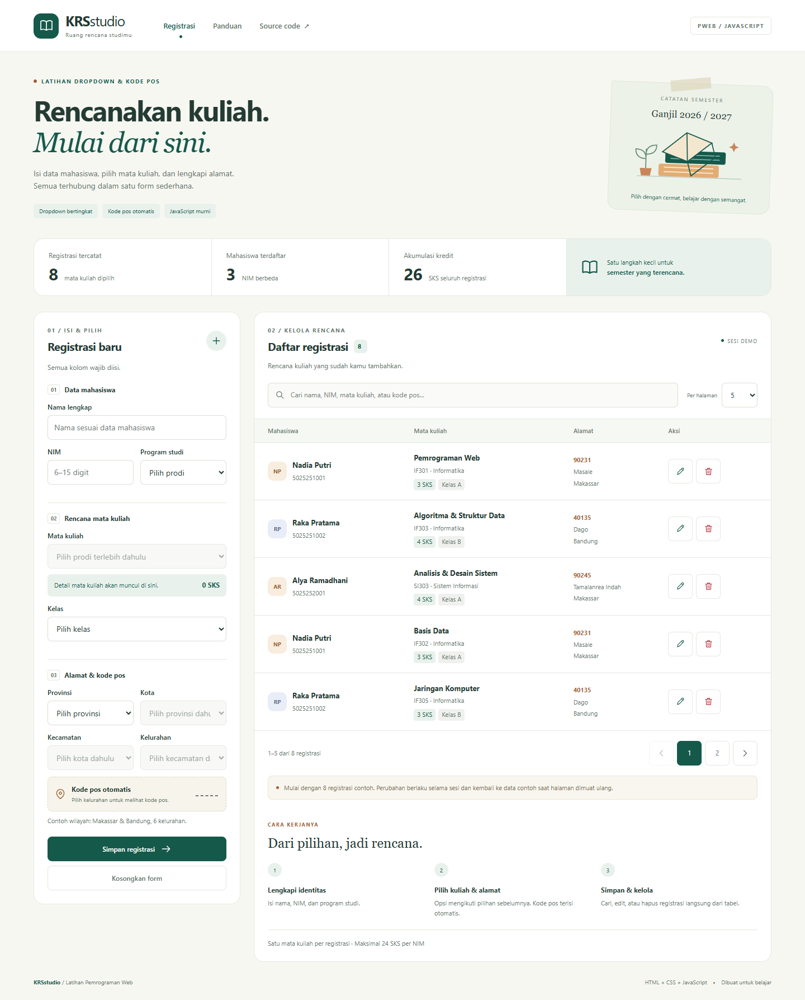

# KRS Studio · PWEB-Javascript

Latihan **Dropdown & Kode Pos JavaScript** berupa registrasi mata kuliah interaktif menggunakan HTML, CSS, dan JavaScript murni. Tampilan menggunakan warna teal, latar krem, dan ilustrasi buku berbentuk SVG lokal.

**Demo:** https://boyeep.github.io/PWEB-Javascript/



## Fitur

- Form nama, NIM, program studi, mata kuliah, kelas, dan alamat.
- Dropdown mata kuliah mengikuti program studi; pilihan lama dikosongkan saat prodi berubah.
- Dropdown bertingkat **provinsi → kota → kecamatan → kelurahan**.
- Kode pos terisi otomatis berdasarkan kelurahan, dengan input `readonly`.
- Validasi kolom wajib dan NIM 6–15 digit; kesalahan tampil sebagai pesan danger merah.
- Tambah, edit, batal edit, dan hapus dengan dialog konfirmasi.
- Pencarian real-time untuk nama, NIM, prodi, mata kuliah, kelas, wilayah, dan kode pos.
- Pagination dengan pilihan 5 atau 10 registrasi per halaman.
- Ringkasan jumlah registrasi, NIM berbeda, dan akumulasi SKS.
- Pencegahan mata kuliah ganda untuk NIM yang sama, walaupun kelasnya berbeda.
- Batas simulasi 24 SKS per NIM; registrasi lama tidak dihitung dua kali ketika diedit.
- Label form, skip link, focus state, dialog native, dan dukungan reduced motion.

## Lingkup latihan

Setiap baris mewakili **satu pilihan mata kuliah**, sehingga satu mahasiswa dapat memiliki beberapa baris. Terdapat 8 registrasi awal dari 3 mahasiswa fiktif dan katalog 8 mata kuliah untuk masing-masing dari 2 prodi. Katalog, nilai SKS, semester, dan batas 24 SKS merupakan contoh untuk latihan.

Data registrasi disimpan pada **array objek di memori browser**. Perubahan berlaku selama halaman terbuka; refresh mengembalikan data contoh. Tidak menggunakan backend, database, atau localStorage.

Dataset alamat dibatasi pada 2 provinsi, 2 kota, 4 kecamatan, dan 6 kelurahan: sebagian wilayah Makassar dan Bandung. Sumber kode pos tercantum di [docs/SOURCES.md](docs/SOURCES.md).

## Menjalankan

Buka `index.html` di browser modern, atau jalankan server lokal dari folder proyek:

```powershell
python -m http.server 8000
```

Buka http://localhost:8000. Tidak memerlukan proses build, framework, atau paket tambahan untuk menjalankan aplikasi. Font menggunakan font sistem dan semua aset tampilan tersedia lokal.

## Struktur

```text
PWEB-Javascript/
├── index.html            # Struktur form, tabel, dan dialog
├── style.css             # Layout, warna, komponen, dan responsivitas
├── data.js               # Katalog kuliah, wilayah, dan data contoh
├── app.js                # Dropdown, validasi, CRUD, pencarian, render
├── assets/favicon.svg
├── screenshots/          # Desktop, mobile, edit, validasi
├── docs/
│   ├── blogspot.html      # Artikel HTML siap tempel ke Blogger
│   ├── BLOGSPOT.md        # Judul dan cara posting
│   └── SOURCES.md         # Referensi kode pos
├── tests/check_app.py     # Pengujian alur pengguna
├── qa-report.json         # Hasil pengujian
└── README.md
```

## Logika JavaScript

`setOptions()` mengganti opsi dropdown dengan elemen `Option`. `updateCourses()` memfilter katalog berdasarkan prodi. `updateRegions()` mengosongkan pilihan turunan setelah pilihan induk berubah. `getPostalCode()` mengambil kode pos dari objek wilayah dan `updatePostalCode()` menuliskannya ke input.

Event `submit` memvalidasi input sebelum memutasi array. `editRecord()` memuat data ke form dan membangun kembali opsi dropdown dari induk ke turunan. Penghapusan baru dijalankan ketika dialog dikonfirmasi.

`render()` memfilter registrasi berdasarkan kata pencarian, mengambil irisan data untuk halaman aktif, lalu memperbarui tabel, badge, ringkasan, dan tombol pagination. Semua teks dari pengguna dirender dengan `textContent`.

## Pengujian

**19 kelompok pemeriksaan lolos**, tanpa error JavaScript/console. Lihat [qa-report.json](qa-report.json). Pemeriksaan meliputi dropdown, reset pilihan turunan, kode pos, validasi, CRUD, pencarian, pagination, batas SKS, input mirip HTML, keadaan kosong, dan refresh sesi. Layout diperiksa pada lebar 375, 768, 812 (landscape), 1024, dan 1440 piksel.

Untuk mengulang pemeriksaan, siapkan Python dan Playwright:

```powershell
python -m pip install playwright
python tests/check_app.py
```

Script menggunakan Chrome lokal jika tersedia. Jika tidak, jalankan `python -m playwright install chromium` terlebih dahulu. Lokasi Chrome lain dapat ditentukan lewat variabel `CHROME_PATH`.

## Blogspot

Salin isi [docs/blogspot.html](docs/blogspot.html) ke editor Blogger dalam mode **Tampilan HTML**. Artikel berisi penjelasan latihan, cuplikan kode, screenshot, tautan repository, dan demo. Petunjuk lengkap tersedia di [docs/BLOGSPOT.md](docs/BLOGSPOT.md).
